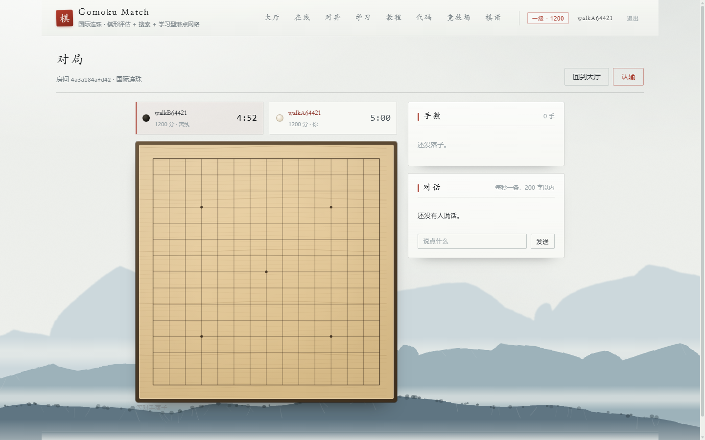
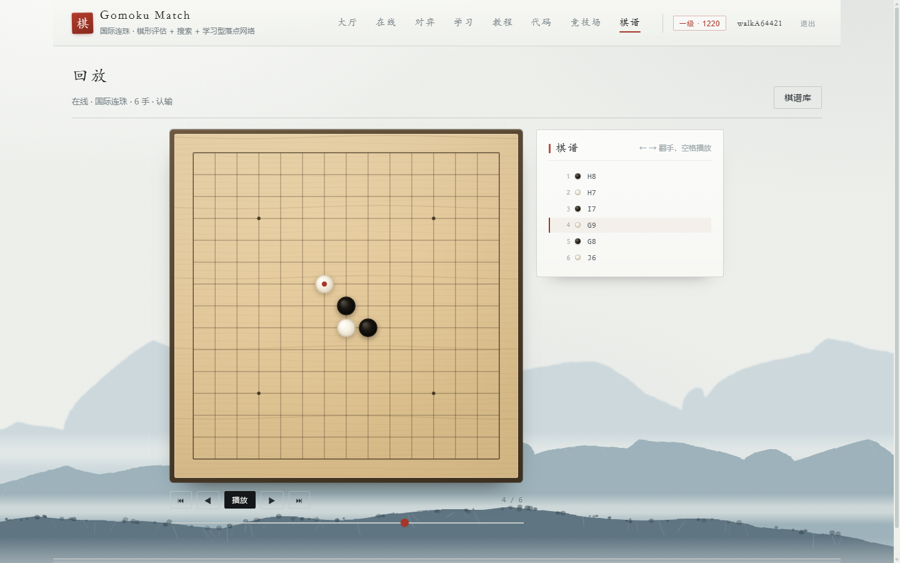
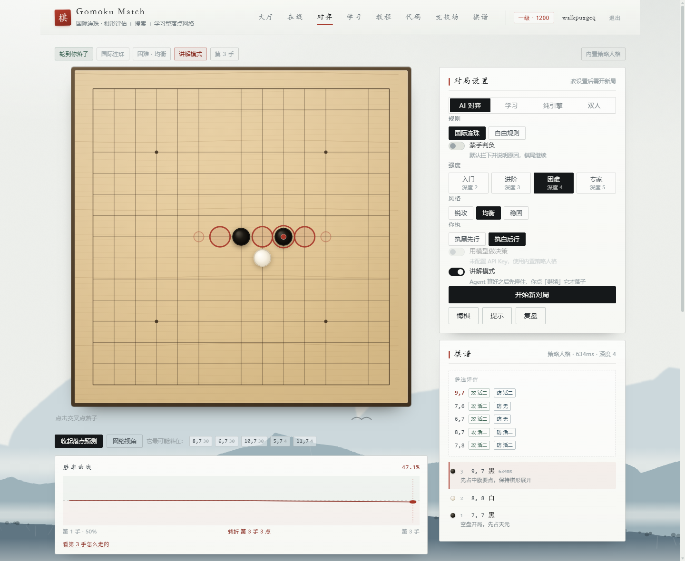

# Gomoku Match

可完整对局的连珠棋平台。两名玩家在浏览器内实时对战，胜负与等级分由服务端判定，棋谱入库并支持逐手回放；人机对局开放禁手判定、棋形识别、搜索与胜率估算，计算过程可查看。

单端口部署：一个 Python 进程同时吐 API、WebSocket 和前端静态文件，SQLite 一个文件带全部状态。

`Python 3.13` · `FastAPI` · `SQLite (WAL)` · `WebSocket` · `React 19` · `Vite 7` · `Docker`

**387 项自动化测试 + 56 项浏览器走查断言**

| 在线对局 | 棋谱回放 |
| --- | --- |
|  |  |

| 大厅 | 逐手解说 |
| --- | --- |
|  |  |

---

## 功能

| 模块 | 说明 |
| --- | --- |
| 在线对战 | 建房／邀请码／快速匹配。服务端权威判定，断线重连，每步加秒的计时 |
| 天梯 | Elo 等级分，13 档段位，只有 rated 对局计分 |
| 棋谱 | 每一手落库，可回放（播放／单步／拖进度），带当时的落点与耗时 |
| 人机对弈 | 四档难度、三种风格，由 Agent 给出落子理由 |
| 学习模式 | 逐手标注棋形名称，教练点评该手形成的棋形与对手活三的拦截情况 |
| 教程 | 四章可交互棋盘，从规则讲到禁手 |
| 代码工坊 | 自己写 `choose_move`，Python 与 C++ 两条通道，同一套沙箱 |
| 算法竞技场 | 随机／贪心／极小极大／神经网络互相对打，可复现 |
| 局面分析 | 胜率曲线、落点份额、逐手解说，都在服务端算完再下发 |

---

## 架构

```
web/  React 19 + Vite —— 大厅 · 在线 · 对弈 · 学习 · 教程 · 代码 · 竞技场 · 棋谱
  │
  │   HTTP /api/*                    WS /ws/game/{id} · /ws/lobby
  ▼
app.py          装配层：中间件链 · 异常统一转换 · SPA 托管
api/            accounts · games · lab · meta · online · socket
─────────────────────────────────────────────────────────────────
online          房间 · 房间码 · 匹配队列
realtime        WS 中心：连接表 · 按人定制快照 · 每秒巡检
settlement      终局结算（幂等）
store           Game 对象：内存热态 + 每手落子持久化
accounts        账户 · 会话 · 战绩
elo · analysis · arena · tutorial · lab
─────────────────────────────────────────────────────────────────
repo.py         ← 全项目唯一写 SQL 的地方
db.py           ← 线程本地连接 · WAL · PRAGMA 迁移
  │
  ▼
data/gomoku.db
```

分层遵循一条约束：**SQL 仅允许出现在 `repo.py`**。上层获取的是 dict 而非 `sqlite3.Row`，更换存储时只需修改该文件。

### 单步落子的处理链路

1. 客户端发 `{"type":"move","x":7,"y":7}`，`api/socket.py` 校验连接、座位、是否轮到你。
2. `realtime.apply_move` 调 `Game.apply`：规则判定（禁手、胜负）在内存里完成，棋盘是增量结构，不整盘重算。
3. 同一个事务里往 `moves` 写一行（`game_id + ply` 是主键，天然幂等）。
4. `view_for(game, user_id)` 生成**按人定制**的快照——你的座位、对手在不在线，两个连接收到的 JSON 不一样。
5. 终局时 `settlement.settle()` 进场，`recorded` 门做幂等，记战绩 + 算 Elo + 广播 `result`。

第 4 步是设计中的关键取舍：广播同一份 payload 实现最简单，但每个客户端需自行判断己方颜色与对手在线状态，判定逻辑将分散至前端。

---

## 数据层

五张表，五个索引。

| 表 | 关键点 |
| --- | --- |
| `users` | `name_key` 存 casefold 后的名字做唯一约束；rating、rated_games、胜负平、连胜与最佳连胜 |
| `sessions` | 主键是 token 的 SHA-256 摘要，库里没有明文 token；带过期时间，读时顺手删过期的 |
| `games` | 双方 id、规则、是否 rated、赛前赛后分、计时参数与两侧余秒、`turn_started` |
| `moves` | `(game_id, ply)` 主键，一手一行 |
| `rooms` | 6 位房间码（去掉 I/O/0/1 这类易混字符），带状态与 reap |

三个工程决定：

**WAL + `BEGIN IMMEDIATE`。** 默认的 rollback journal 下读写互相阻塞，两个浏览器同时落子就能撞出 `SQLITE_BUSY`。WAL 使读操作不阻塞写操作，写事务起始即获取写锁（`BEGIN IMMEDIATE`），不采用锁升级机制，冲突表现为排队而非报错。`synchronous=NORMAL` 再省一次 fsync——WAL 模式下丢最近若干事务不会坏库，这个取舍划算。

**每线程一个连接。** `sqlite3` 的连接对象不能跨线程用，`threading.local` 比连接池简单，也不会因为忘记归还而泄漏。写冲突由 `busy_timeout` 兜底。

**迁移只追加。** `PRAGMA user_version` 记录版本，`MIGRATIONS` 为只追加列表，启动时从当前版本向后执行。已执行的迁移不再修改，该约定写在文件头注释中。

### 冷热分层存储

`Game` 对象在内存中持有完整 `Position`：搜索、胜率曲线与禁手判定均高频读取，若每次访问数据库将无法满足性能要求。持久化只做两件事：每手写入一行 `moves`，重启时按 `ply` 顺序重放。

重放同时恢复计时：`turn_started` 为绝对时间戳，进程重启后回合剩余秒数仍可正确计算。内存最多保留 400 局热态，超出部分按最久未活动淘汰，再次进入时从数据库载入。

---

## 在线对战

WebSocket 协议较为精简，共十余种消息：

| 方向 | 消息 | 说明 |
| --- | --- | --- |
| C→S | `hello` / `sync` | 建连后要一次全量快照；断线重连后也是这个 |
| C→S | `move` / `resign` / `chat` / `ping` | 落子、认输、聊天（每秒一条、200 字）、心跳 |
| S→C | `hello` / `state` / `presence` / `chat` / `result` / `pong` / `error` | `state` 是按人定制的 |

关闭码带语义：`4401` 未登录、`4403` 不是这局的人、`4404` 局不存在。前端识别这三个关闭码，**收到后不再重连**，否则失效 token 会导致页面每 8 秒持续重试。正常断线按 400ms 起、翻倍到 8s 退避，连上先发 `sync` 拿最新局面。

心跳 25 秒一次。反向代理通常 60 秒断空闲连接，留了一倍余量。

**计时不在服务端每秒广播。** 一手落子下发一次剩余秒数，前端自己跑本地倒计时；服务端有个守护线程每秒扫一遍所有热局，超时了才判负并广播。这样一百个观众也不会让服务端每秒发一百条消息。

**匹配队列**按分数窗口找对手：初始 ±150，每等 5 秒放宽 100，上限 ±800。队列规模较小，直接采用 O(n²) 扫描，无需引入额外数据结构。

---

## 等级分

采用标准 Elo 公式：`1/(1+10^((Rb-Ra)/400))` 算期望胜率，`新分 = 旧分 + K × (实际 − 期望)`。

只有两处取舍：

- **K 因子按已下盘数衰减**：15 盘内 40（新号快速定位）、60 盘内 24、之后 16（抗抖动）。不是原创，国际棋联同一套思路。
- **下限 100，上限不设**。下限避免负分展示；上限开放用于拉开头部区分度。

涨跌量互为相反数，总分守恒（测试里有断言）。段位 13 档，从五级到名人。天梯仅统计 rated 对局：人机难度由用户自选，使用入门难度累积的胜场不具备参考意义。

---

## 可观测性

未引入 Prometheus 客户端与结构化日志库。指标、日志、限流三部分合计 340 行（`server/observability.py`），满足需求且无额外依赖：

**指标。** 自写的 counter / histogram / gauge，`/api/metrics` 直接吐 Prometheus 文本格式。请求量与延迟直方图、在线人数、活局数、匹配队列长度、热态局数、被限流的请求数、WS 连接数、落子数。

标签只按**路由模板**打（`/api/games/{game_id}`），不按真实路径。真实路径由外部输入决定，扫描器可将时间序列规模放大至数万条，写入 Prometheus 后难以清理。限流计数器同理，按命中的规则前缀分桶。

**日志。** 单行 JSON：`ts / level / logger / msg / request_id / method / path / status / ms / route`。`request_id` 继承自 `X-Request-Id`，缺省时生成并写回响应头，前端反馈问题时提供的 id 可直接对应服务端日志。

**限流。** 固定窗口计数，按 IP 或按 token 分桶，定时 GC 过期桶。登录/注册 30 次每分钟按 IP，改密码 20 次按用户，默认 1200 每分钟。取客户端 IP 时用 `X-Forwarded-For` 的**最后一跳**——前面的可以随便伪造。

两个探针分工不同：

- `/api/health` 不碰磁盘，只证明进程活着（liveness）。
- `/api/ready` 真跑一次数据库写入 + 检查前端产物在不在，任一失败返回 503（readiness）。

容器 HEALTHCHECK 使用 `ready`：仅返回 200 而数据库不可用，不满足就绪条件。

---

## 测试

```bash
python tools/run_tests.py            # 全部，自己起服务、临时库、随机端口
python tools/run_tests.py --fast     # 跳过端到端套件
python tools/walk_online.py          # 在线对战走查（自己起服务和浏览器）
python tools/walk_analysis.py        # 分析页走查
```

| 套件 | 覆盖 | 项数 |
| --- | --- | --- |
| `test_engine.py` | 禁手递归、长连、胜负、搜索、棋形 | 37 |
| `test_lab.py` | 代码沙箱、行协议、超时与越权 | 28 |
| `test_insight.py` | 胜率、落点份额、解说、逐手分析 | 104 |
| `test_storage.py` | 迁移、WAL、会话、棋谱重放、Elo、旧数据导入 | 94 |
| `test_api.py` | 接口契约、鉴权、越权 403、限流与指标分桶 | 72 |
| `test_online.py` | 房间、双向落子、认输结算、匹配、天梯 | 52 |
| `walk_online.py` | 两个浏览器真的下一盘 | 25 |
| `walk_analysis.py` | 胜率曲线、待确认落子、逐手回看 | 31 |

合计 **387 + 56**。

`tools/run_tests.py` 每次起一个独立进程（临时库、随机端口、`NO_PROXY`），跑完删干净——测试之间不共享状态，也不会污染 `data/gomoku.db`。

### 浏览器走查的断言范围

接口测试无法验证交互行为。走查脚本通过 CDP 直连 DevTools 协议，启动**两个**浏览器实例（同一浏览器内标签共享 localStorage，两个账号的 token 会互相覆盖），分别登录、交替落子、认输，随后校验：

- 棋盘上真的有六颗子（读 DOM，不是读接口）
- 结算卡片上写的是「你赢了」还是「你输了」，胜方分数确实涨了
- 棋盘连同下面的说明**完整在首屏内**，没有横向滚动
- 拖进度条之后手数真的跳到第 4 手

最后一条断言最初未生效：直接给 `<input type="range">.value` 赋值时 React 认为值未变化，`onChange` 不触发，截图仍停留在第一手。改为调用原生 setter 后 dispatch `input`，并补充针对 `.replay-count` 文本的断言。

---

## 部署

```bash
make docker            # 两阶段构建：node 编译前端，python 运行
make docker-run        # docker compose up -d，数据挂在 gomoku-data 卷
```

镜像里没有 `node_modules` 也没有工具链：前端在 `node:22-alpine` 阶段编译成静态文件，运行镜像只拷 `dist/`。以 uid 10001 的非 root 用户跑，`/data` 单独建目录并 chown，挂卷时权限才对得上。

| 变量 | 默认 | 说明 |
| --- | --- | --- |
| `PORT` | `8000` | 容器里必须绑 `0.0.0.0`，不要写 `127.0.0.1` |
| `GOMOKU_DB` | `data/gomoku.db` | 父目录自动创建；只读文件系统下降级成内存库 |
| `GOMOKU_LOG` | `INFO` | 日志级别，输出是单行 JSON |
| `GOMOKU_CORS` | 本地两个端口 | 线上同源部署，留空即可 |
| `GOMOKU_LLM_*` | 空 | 可选的模型接入，任何 OpenAI 兼容接口都行；不配就用内置人格决策 |

单进程是有意的：对局状态在内存里，多 worker 会让两个进程各持一半棋局。要横向扩，得先把热态搬到共享存储，那是另一个量级的改造，不在当前取舍里。

CI 跑矩阵：Python 3.11 与 3.13 × Node 22，`compileall` → 全部测试 → `docker build`（不推送）。

---

## 目录结构

```
server/
  app.py            装配层：中间件、异常处理、SPA 托管
  db.py  repo.py    连接与迁移 / 唯一 SQL 出口
  store.py          Game 对象、冷热双存、重放
  accounts.py       账户、会话、结算
  online.py         房间、房间码、匹配
  realtime.py       WS 中心、按人快照、每秒巡检
  settlement.py     终局结算（幂等）
  elo.py            等级分与段位
  observability.py  指标、JSON 日志、限流、安全头
  runtime.py        进程级单例，打断循环引用
  api/              accounts games lab meta online socket deps
  gomoku/
    rules.py        禁手与胜负判定
    position.py     棋盘与增量状态
    shapes.py       棋形识别
    search.py       迭代加深 + 置换表
    analysis.py     胜率与落点份额
    agent.py        人格决策
    algorithms.py   随机 / 贪心 / 极小极大
    net.py          局面价值网络
    coach.py        点评   insight.py  逐手解说   llm.py  可选模型
web/src/
  App.jsx           路由、导航、ErrorBoundary
  pages/            Hub Online Room Replay Play Learn Tutorial Code Arena
  components/       Board、面板、控件
  lib/              api.js（fetch 封装）ws.js（心跳与退避重连）
tests/              六套后端套件
tools/              run_tests.py、walk_online.py、cdp.py
engine/             可选的 C++ 加速通道
```

---

## 本地运行

```bash
make install      # pip install -r requirements.txt + npm install
make dev          # 后端 :8000 + Vite :5173 热更新
make serve        # 先构建前端，再单端口跑（和线上一致）
make test         # 全部测试
make clean        # 清构建产物与缓存，不动 data/
```

修改样式后验证布局，执行 `python tools/walk_online.py`：脚本固定视口为 1440×900 后截图，结果可复现。

---

## 规则与引擎

**三三判定要递归。** 一个“三”成立，必须存在一个补点能把它变成活四；而这个补点本身不能是黑棋的禁手点，否则是假活三。于是判三要先判四，判四又要判它会不会是禁手：

```python
after = stones.put(gap, color)                    # 假设补一子
four = _open_four(after, ex, ey, dx, dy, color)
if four is None or center not in four:
    continue
if depth > 0 and _forbidden(after, ex, ey, color, depth - 1) is not None:
    continue                                      # 补点本身是禁手 → 假活三
found.add(frozenset(i for i in four if i != gap))
```

递归最多两层：每补一子棋盘减少一个空点，不会无限递归。该差异直接影响判定结果——测试用例中，不带递归计得 2 个活三（误判三三禁手），带递归计得 1 个（合法）。

**“四”用四颗子的位置集合去重。** 活四两头都能成五，按"成五点的个数"数，任何活四都会变成两个四，于是每个活四点都成了四四禁手。`_XXXX_` 从左窗口、右窗口各命中一次，但那是同一组四颗子，只算一个。

**引擎在候选排序阶段即滤除禁手点**，判定结果按 `(局面哈希, 落点)` 缓存：迭代加深会反复回到同一局面，不缓存时该步骤的开销高出一个数量级。代价是深度 5 单次搜索由 1.2s 增至 1.9s；收益是不再将禁手点作为进攻手段——同一局面下，未做过滤的版本会给出 899 万分的“必胜”判定，实际为三步后的长连禁手。

**落点价值采用增量评分**，不做整盘重算：每落一子只更新受影响的四条线及其棋形。`shapes.py` 中“再补一子会变成什么”的判定由搜索、学习模式与局面分析三处共用。

**网页对局默认把禁手拦下来并说明原因**（棋盘上标红叉），让人先看懂规则；设置里可以切成赛制模式：落子即判负，结果栏写明是哪一种禁手。

---

## API

| 域 | 路由 |
| --- | --- |
| 账户 | `POST /api/auth/register\|login\|logout\|password` · `GET /api/auth/me` |
| 天梯 | `GET /api/leaderboard` · `GET /api/profile/{name}` · `GET /api/history` |
| 对局 | `POST /api/games` · `GET /api/games/{id}` · `POST /api/games/{id}/move\|undo\|resume\|hint\|review\|explain` |
| 在线 | `GET\|POST /api/rooms` · `GET /api/rooms/{code}` · `POST /api/rooms/{code}/join` · `DELETE /api/rooms/{id}` · `GET /api/online/stats` |
| 实时 | `WS /ws/game/{game_id}` · `WS /ws/lobby` |
| 实验室 | `GET /api/lab/capabilities\|samples` · `POST /api/lab/match\|verify` · `POST /api/arena/match` · `POST /api/neural/scan` · `POST /api/botzone` |
| 元 | `GET /api/health\|ready\|metrics\|config\|system\|tutorial\|algorithms` |

---

## 问题记录

**代理环境变量会劫持 127.0.0.1。** 环境存在 `HTTP_PROXY` 时，httpx 默认 `trust_env=True`，访问本地测试服务同样经过代理并返回 502。测试客户端统一 `trust_env=False`，跑测试的脚本设 `NO_PROXY`，CDP 客户端单独建了一个空 `ProxyHandler` 的 opener。

**单文件 JSON 存账户的写放大。** 早期账户存在一个 JSON 文件里，每次读 token 要遍历全部会话（O(n)），每次写要落整个文件。换成 SQLite 之后 token 是主键查询，写只碰一行。旧数据做了幂等导入：保留原 token 摘要，用 `user_exists` 做门，重复跑不会造出重复账户。

**棋盘按列宽计算高度会超出视口。** 棋盘为正方形，仅按列宽推导宽度而忽略高度：1416×948 下计算为 678px，叠加页头、玩家条与说明文字后下沿被裁切。改为按“视口高度 − 固定开销”反推最大边长，整体布局随之收窄居中；若只压缩棋盘，右侧栏会远离，左右失衡。走查脚本已补充两条断言覆盖该问题。

**指标标签基数存在风险。** 第一版按真实路径打标签，`/api/games/{id}` 每局一个新 id，时间序列只增不减。改成路由模板之后标签是闭集。

**同一浏览器的两个标签共享 localStorage。** 双人对战走查最初全部失败：第二个标签登录后覆盖第一个标签的 token，第一个页面变为未登录状态。改为两个浏览器实例（两个 DevTools 端口、两份临时 profile）后才能覆盖真实场景。

---

## 许可

MIT
