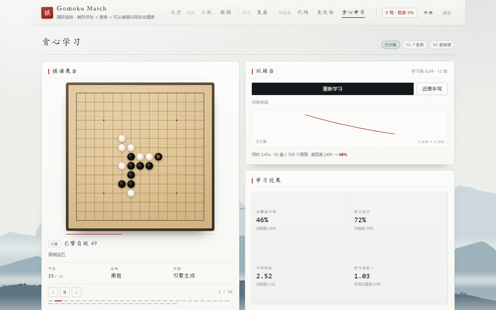
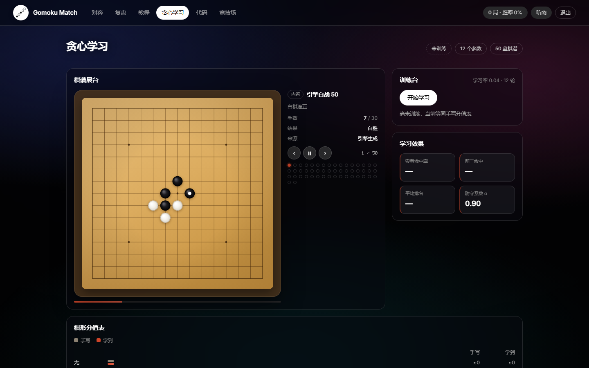
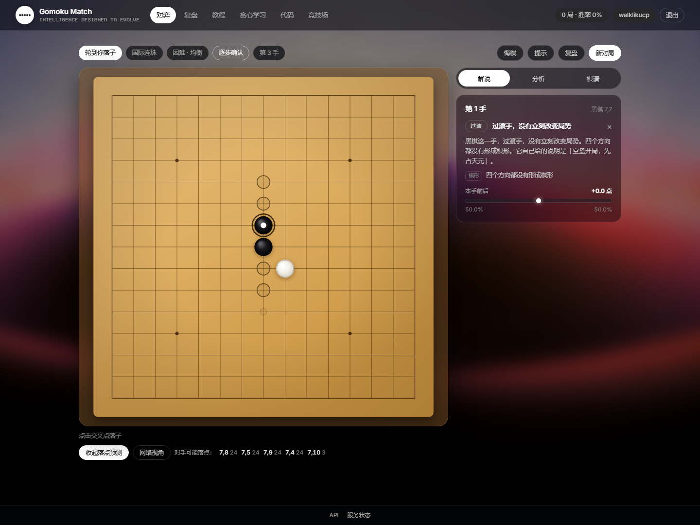
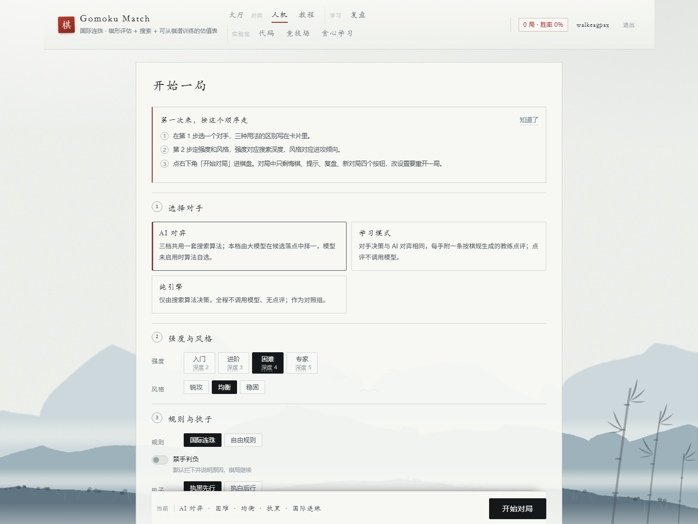

# Gomoku Match

[](https://gomoku-match.app.workbuddy.host/?sharecode=MJAKMJUVAA)
[](#测试与验证)
[](#测试与验证)
[](LICENSE)

面向 15×15 国际连珠（Renju）规则的对弈与算法实验平台，提供人机对弈、算法竞技场、自定义策略三类对局方式，以及基于棋谱训练贪心权重的实验页面。

单进程单端口部署：Python 进程同时提供 REST API 与前端静态资源；对局状态持久化于 SQLite，棋谱与训练权重存放于运行时数据目录。

`Python 3.13` · `FastAPI` · `SQLite (WAL)` · `原生 JS 静态 MPA` · `Docker`

**在线演示**：[gomoku-match](https://gomoku-match.app.workbuddy.host/?sharecode=MJAKMJUVAA)

后端测试 459 项、浏览器走查 189 项，全部通过。

| 贪心学习：训练之后的对照表 | 棋谱展台 |
| --- | --- |
|  |  |

| 首页 | 逐手解说 |
| --- | --- |
|  |  |

## 1. 项目背景

五子棋规则简明，但工程实现涵盖棋形识别、搜索、禁手判定、状态恢复与算法对比等完整链路。现有的开源五子棋项目多聚焦单一维度：或只提供对弈，或只演示算法，缺少可对照、可训练、可复现的实验环境。

本项目将「对弈产品」与「算法实验台」合并：用户既能以四档强度对弈，也能在竞技场对比五种策略，并用真实棋谱训练贪心权重，观察分值表的变化。

## 2. 目标用户与使用场景

| 角色 | 核心场景 |
| --- | --- |
| 五子棋爱好者 | 人机对弈、学习模式逐手点评、复盘分析 |
| 算法学习者 | 对比随机 / 贪心 / 学习型贪心 / 极小极大 / 神经网络五种策略 |
| 教学与课程演示 | 六章交互式教程，覆盖棋规、棋形、禁手与开局规则 |
| 开发者 | 在代码工坊编写 `choose_move`，经沙箱运行后参与对局 |

## 3. 问题定义

| 问题 | 现状 | 目标 |
| --- | --- | --- |
| 对弈与算法实验割裂 | 对弈产品不开放策略对比 | 同一套引擎支撑对弈、竞技场与自定义策略 |
| 算法效果不可复现 | 对局结果受开局随机性影响 | 竞技场固定种子，结果可复现 |
| 棋力评估缺少数据依据 | 贪心权重靠人工设定 | 用棋谱训练权重，以验证集指标评估 |
| 无逐步讲解 | 仅给出落点 | 学习模式标注棋形、点评落点与对手威胁 |

## 4. 产品目标与指标

| 目标 | 指标 | 当前结果 |
| --- | --- | --- |
| 规则实现完整 | 后端测试 | 459 项通过 |
| 交互无回归 | 浏览器走查 | 189 项通过 |
| 权重训练有效 | 验证集 top-1 命中率 | 24.2% → 46.4% |
| 布局稳定 | 七页 × 五档宽度的横向溢出检查 | 通过 |
| 对局可恢复 | 进程重启后按 `ply` 重放 | 支持 |

## 5. 功能范围

| 模块 | 说明 |
| --- | --- |
| 人机对弈 | 四档强度、三种风格；可选执子与规则，对局中可悔棋、提示 |
| 学习模式 | 逐手标注棋形名称，点评该手形成的棋形与对手活三的拦截情况 |
| 复盘分析 | 逐手回看，胜率曲线、落点份额与解说跟随手数 |
| 贪心学习 | 手写分值表与学到的分值表并排对照；棋谱轮播、上传棋谱、训练过程实时可见 |
| 算法竞技场 | 随机 / 贪心 / 学习型贪心 / 极小极大 / 神经网络两两对打，结果可复现 |
| 代码工坊 | 自行编写 `choose_move`，Python 与 C++ 两条通道共用同一套沙箱 |
| 教程 | 六章可交互棋盘，从棋规、棋形讲到禁手与开局规则 |

### 5.1 三种对局模式的差异

三种模式共用同一套搜索算法（棋形评估 + 极小化极大），没有任何一档由神经网络直接决策。差异在于候选落点的最终选择方，以及是否生成逐手点评。

| 模式 | 落点选择 | 每手点评 |
| --- | --- | --- |
| AI 对弈 | 搜索算法给出候选，再由大模型选择；关闭模型、入门难度（`noise=0.55`）或模型调用失败时，回落至人格权重 + 噪声 | 无 |
| 学习模式 | 与 AI 对弈一致 | 有，由 `coach.py` 按棋形规则生成，不调用模型 |
| 纯引擎 | 仅使用搜索算法，`use_llm` 强制为 `False` | 无 |

判定逻辑位于 `games.py`：`use_llm = req.use_llm and mode in ("agent", "learn")`，`agent.decide` 再叠加 `LLMConfig().enabled and noise < 0.5`。专家难度（`topk=1`）下候选池仅一个落点，模型只生成解说；竞技场中的神经网络策略为独立实现，不参与主线对弈。

### 5.2 页面职责

| 页面 | 职责 |
| --- | --- |
| `play.html` 开局准备 | 选择对手、难度、规则、执子 |
| `play.html?game={id}` 对局 | 棋盘与右侧三个页签（解说 / 分析 / 棋谱），顶部四个操作 |
| `replay.html` 复盘 | 逐手回看与分析面板 |
| `greedy.html` 贪心学习 | 查看棋谱、上传棋谱、观察权重变化 |

配置与操作分离：难度与规则属于开局参数，悔棋与提示属于对局操作。对局结束后悔棋禁用，避免已结算战绩被重复记录。



## 6. 界面与技术约束

界面未引入 UI 框架，全部为手写 CSS 与原生 JS。`web/site` 为线上静态站源码，非构建产物；页面直接引用 `app.css`、`styles.css` 与 `pages/*.js`，无打包步骤。字体、图标、背景视频与徽章均为本地文件，不依赖外部 CDN。

**设计令牌集中于 `app.css` 的 `:root`**。底色 `--bg #050507`；正文 `--muted #a3a3a3`、`--dim #828282`；玻璃面板 `--panel rgba(9,10,14,.54)` 与 `--panel-2 rgba(26,27,33,.6)`，统一 `blur(28px) saturate(1.4)`；强调色仅两支：朱砂 `--seal #cf4529` 表示热、学到、上调与进行中，石青 `--jade #4e9a8f` 表示冷、基线、下调与对照；棋盘专用木色 `--wood #dcac5f`。

**标识为单色五子**。五子斜线、末子留白，仅使用黑白灰。矢量文件位于 `web/site/assets/logo.svg`，顶栏、登录页与 favicon 共用。


**背景为视频**。首页、登录页与内页共用一段极光视频；`app.js` 的 `mountBackdrop()` 为内页注入 `.bg` 层，`login.html` 自带一层并做查重。视频上叠加 `mix-blend-mode: screen` 色层与压暗层，保证文字对比度；`prefers-reduced-motion` 下隐藏视频，保留静态渐变。

**棋盘采用榧木渐变**（`#e9c07c → #dcac5f → #c89442`），墨线网格、白子深描边；禁手叉与胜利连线用朱红，热力与落点预测用偏红色系，避免在木色底上消失。

**代码工坊提供语法高亮**。`pages/code.js` 用手写扫描器输出 token，透明 `textarea` 叠加在 `.code-hl` 上并同步滚动；两层共用字体、行高、内边距与 tab-size，避免光标错位。

## 7. 技术架构

```text
web/site/       原生 JS 静态 MPA —— 首页 · 登录 · 对局 · 复盘 · 教程 · 贪心学习 · 代码工坊 · 竞技场
  │
  │   HTTP /api/*
  ▼
app.py          装配层：中间件链 · 异常统一转换 · 静态站点托管
api/            accounts · games · lab · meta · greedy
─────────────────────────────────────────────────────────────────
settlement      终局结算（settled 落库，幂等，单人去向）
store           Game 对象：内存热态 + 每手落子持久化
accounts        账户 · 会话 · 战绩
corpus          棋谱库：内置种子 + 用户上传，三种格式解析
tuning          可学习贪心：特征、评分、训练、权重表
analysis · arena · lab · botzone · tutorial
─────────────────────────────────────────────────────────────────
repo.py         ← 全项目唯一写 SQL 的位置
db.py           ← 线程本地连接 · WAL · PRAGMA 迁移
  │
  ▼
data/gomoku.db    data/corpus.json    data/greedy_model.json
```

分层约束：SQL 仅允许出现在 `repo.py`；上层获取 dict 而非 `sqlite3.Row`，更换存储时仅需修改该文件。

### 7.1 一次落子的处理链路

1. 客户端 `POST /api/games/{id}/move`，`api/games.py` 校验归属、轮次与规则。
2. `Game.apply` 在内存中判定禁手与胜负。棋盘为增量结构：每落一子仅更新受影响的四条线，不重算整盘。
3. 同一事务内向 `moves` 写入一行。`game_id + ply` 为主键，重复写入天然幂等。
4. 轮到 Agent 时同步计算应手，返回落点、解说与候选份额；讲解模式下暂停，等待用户确认。
5. 终局时 `settlement.settle()` 执行，`recorded` 门与 `games.settled` 列共同保证幂等，随后记录战绩与终局状态。

第三步保证进程重启后可恢复：内存仅保留热态，每手落库一行，重启时按 `ply` 重放即可还原局面。

## 8. 数据设计

四张表，四个索引。

| 表 | 关键设计 |
| --- | --- |
| `users` | `name_key` 存储 casefold 后的名字并加唯一约束；胜负平、连胜与最佳连胜 |
| `sessions` | 主键为 token 的 SHA-256 摘要，库中不存储明文；带过期时间，读取时清理过期记录 |
| `games` | 建局人、模式、难度、规则、禁手策略、`human_color`、终局原因与胜利连线 |
| `moves` | `(game_id, ply)` 主键，一手一行，带来源、耗时与评估值 |

三项工程决定：

- **WAL + `BEGIN IMMEDIATE`**。默认 rollback journal 下读写互相阻塞，落子与查询并发时触发 `SQLITE_BUSY`。WAL 让读不阻塞写；写事务起始即取写锁，冲突时排队等待。`synchronous=NORMAL` 减少一次 fsync，WAL 下丢失最近若干事务不会损坏数据库。
- **每线程一个连接**。`sqlite3` 连接对象不能跨线程使用，`threading.local` 比连接池简单且不会泄漏；写冲突由 `busy_timeout` 处理。
- **迁移只追加**。`PRAGMA user_version` 记录版本，`MIGRATIONS` 为只追加列表，启动时从当前版本向后执行。真人房功能下线时新增只追加的 v2，删除废弃列与 `rooms` 表；顺序不可交换，`DROP COLUMN` 遇到引用该列的索引会报错。

### 8.1 冷热分层

`Game` 对象在内存中持有完整 `Position`，搜索、胜率曲线与禁手判定均为高频读取。持久化仅做两件事：每手写入一行 `moves`，重启时按 `ply` 顺序重放。内存最多保留 400 局热态，超出按最久未活动淘汰，再次进入时从数据库载入。重放时补充一次终局判定，覆盖进程在落子后、写状态前退出的场景。

## 9. 可学习贪心

贪心策略的评估函数为一张十二项棋形分值表。初始版本由人工设定 `WEIGHT`（活四 1000 万、冲四 15 万、活三 1500、眠二 30），数值之间仅有粗略倍数关系，缺少数据依据。`greedy.html` 使用棋谱训练该组权重。

### 9.1 参数与特征

```text
score = Σ_r w[r] · (f_own[r] + α · f_opp[r]) + 邻域·w1 + 中腹·w2 + 手数·w3
```

- **19 维特征**：8 档己方棋形 + 8 档对方棋形（落子后形成）+ 邻域已有子数 + 离天元距离 + 当前手数占比。后三项表达开局偏好中腹、残局偏好贴身等先验。
- **12 个参数**：8 个棋形权重 + 3 个辅助权重 + 1 个防守系数 α。
- **防守与进攻共用权重**，仅相差系数 α。第一版为防守设置 8 个独立权重，训练后全部收敛至 0：样本仅数百条时，对手威胁与己方机会的梯度相互抵消，模型退化为只优化进攻。改为共用权重后，α 收敛至 1.03，即「对手活三比己方活三更值得封堵」由数据得出。

### 9.2 训练目标

行为克隆。棋谱中的实际落子为正样本，同一局面的其他候选为负样本，对候选集做 softmax 交叉熵：

```text
loss = -log softmax(score)[target]
```

候选集按手写分值取前 20 个（每步约两百个空点，多数为噪声），目标手保证在集合内。优化器为手写 Adam（lr 0.04、12 轮、L2 约束至手写初值），纯 Python 实现，不依赖 numpy；样本量为千级，单轮训练耗时数十毫秒。

### 9.3 领域约束投影

每轮更新后将权重投影回可行域，三条约束均来自棋理：

- 空棋形不计分（`w[0] = 0`）；
- 分值随棋形强度单调递增（活四 ≥ 冲四 ≥ 活三 ≥ …）；
- 防守系数限定在 `[0.2, 1.6]`，并保留余量，避免落在边界导致梯度恒为零。

不做投影时，模型会将「眠二」权重压为负值以拟合噪声，对照表失去可解释性。

### 9.4 评估指标

初期以「训练后与贪心对局 4 盘」为指标，结果稳定为 0:4。单局胜负主要取决于执黑方与开局随机性，无法反映权重质量，因此改用验证集复现率：

| 指标 | 含义 | 训练前 | 训练后 |
| --- | --- | --- | --- |
| 实着命中率 top-1 | 第一选择即棋谱落点 | 24.2% | **46.4%** |
| 前三命中 top-3 | 前三个候选中包含目标 | 50.3% | 71.9% |
| 平均排名 | 目标手的排位（越小越准） | 5.52 | 2.52 |

验证集取样本序列末 1/5，按序切分而非随机切分：同一局的相邻局面特征高度相似，随机切分会使验证集混入训练时已见局面，导致命中率虚高。三项指标衡量对棋谱的复现程度，而非棋力；实际对局表现可在竞技场选择「学习型贪心」观察。

### 9.5 棋谱来源与格式

内置 50 盘、2067 手，由 `tools/make_corpus.py` 生成：深度 2 的 alpha-beta 与深度 1 对打，每盘轮换执深搜一方。早期以贪心 + 噪声自战生成，棋局仅 13–27 手，训练结果退化为对手写分值表的模仿（eval 0.25）。改用带搜索的棋谱后，同一套代码的 top-1 从 24.2% 提升至 46.4%（验证集为末 1/5 的 153 个局面）。

棋谱库同时接收用户上传，支持三种格式：

```text
(;GM[1]SZ[15];B[hh];W[hi])     SGF
[[7,7],[8,8]]                  JSON
H8 H9 I9  /  7,7 8,8           人类坐标
```

解析后重放校验合法性：重复落子、坐标越界、少于 5 手均返回错误；连五之后的手数自动截断，以处理认输前继续落子的棋谱。训练过程通过 SSE 推送，前端实时显示轮次与损失，而非轮询等待。

## 10. 可观测性与运维

未引入 Prometheus 客户端与结构化日志库，指标、日志、限流三部分合计约 340 行（`server/observability.py`），无第三方依赖。

- **指标**：自写 counter / histogram / gauge，`/api/metrics` 输出 Prometheus 文本格式，覆盖请求量与延迟直方图、活局数、热态局数、被限流请求数、落子数、棋谱上传与训练次数。标签仅按路由模板（如 `/api/games/{game_id}`）打点，不按真实路径，避免外部输入放大时间序列规模。
- **日志**：单行 JSON，字段为 `ts / level / logger / msg / request_id / method / path / status / ms / route`。`request_id` 继承 `X-Request-Id`，缺省时生成并写回响应头。
- **限流**：固定窗口计数，按 IP 或 token 分桶并定时回收。登录与注册 30 次/分钟（按 IP），改密码 20 次/分钟（按用户），默认 1200 次/分钟。客户端 IP 取 `X-Forwarded-For` 的最后一跳。
- **探针**：`/api/health` 不访问磁盘，仅证明进程存活；`/api/ready` 实际执行一次数据库写入并检查前端静态站，任一失败返回 503。容器 `HEALTHCHECK` 使用 `ready`。

## 11. 质量验证

```bash
python tools/run_tests.py            # 后端六套，自行启动服务、临时库、随机端口
python tools/run_tests.py --fast     # 跳过需要服务的端到端套件
python tools/walk_greedy.py          # 贪心学习页走查
python tools/walk_analysis.py        # 准备页 / 对局页 / 复盘页走查
python tools/walk_layout.py          # 七页 × 五档宽度的横向溢出复检
python tools/walkthrough.py          # 全站八个页面走查
```

| 套件 | 覆盖 | 项数 |
| --- | --- | ---: |
| `test_engine.py` | 禁手递归、长连、胜负、搜索、棋形 | 37 |
| `test_lab.py` | 代码沙箱、行协议、超时与越权 | 28 |
| `test_insight.py` | 胜率、落点份额、解说、逐手分析 | 104 |
| `test_storage.py` | 迁移、WAL、会话、棋谱重放、单人结算、结算标记、旧数据导入 | 88 |
| `test_greedy.py` | 棋谱解析、棋谱库、参数投影、训练与验证指标 | 85 |
| `test_api.py` | 接口契约、鉴权通道、静态目录边界、越权 403、训练流、限流与指标分桶 | 117 |
| `walk_greedy.py` | 轮播、训练流、分值表、上传删除、窄屏断点 | 47 |
| `walk_analysis.py` | 准备页选项、页签切换、待确认落子、逐手回看 | 53 |
| `walk_layout.py` | 七个页面在 1440/1100/900/760/414 下无横向滚动条 | 42 |
| `walkthrough.py` | 注册、首页、教程、对弈、学习、代码工坊、竞技场、战绩 | 47 |

`tools/run_tests.py` 每次启动独立进程（临时库、随机端口、临时数据目录、`NO_PROXY`），结束后清理，测试之间不共享状态。数据目录需与库文件一同切换，仅替换库文件会覆盖已训练的权重表。

浏览器走查通过 CDP 直连 DevTools 协议，固定视口后截图，使布局断言可复现。走查覆盖棋盘逐手推进（断言手数增长而非固定时长）、悬停暂停轮播（派发真实鼠标事件）、训练进度轮询采样、分值表色条边界、上传与删除后列表状态。`walk_layout.py` 同时检查页面 `scrollWidth` 是否超过视口，以及是否存在越过视口边缘的元素——仅检查前者不足，元素溢出且父级为 `overflow: hidden` 时不出现滚动条但内容已被裁切。

## 12. 范围边界

- **单进程部署**：对局状态保存在内存中，多 worker 会导致各进程持有部分棋局。横向扩展需先将热态迁移至共享存储，属于独立改造范围。
- **单一存储**：SQLite 满足当前并发规模，未引入外部数据库。
- **前端无构建**：静态 MPA 直接交付，不支持组件化开发；换取零构建依赖与更低的部署复杂度。
- **模型为可选能力**：未配置 `GOMOKU_LLM_*` 时使用内置人格策略，不发起外部请求。

## 13. 部署

```bash
make docker            # 单阶段构建：Python 运行时 + web/site 静态文件
make docker-run        # docker compose up -d，数据挂载在 gomoku-data 卷
```

镜像不含 Node、`node_modules` 与前端工具链，`web/site` 直接复制。以 uid 10001 的非 root 用户运行，`/data` 单独建目录并 chown，保证挂载卷权限正确。

| 变量 | 默认 | 说明 |
| --- | --- | --- |
| `PORT` | `8000` | 容器内必须绑 `0.0.0.0` |
| `GOMOKU_DATA` | `data/` | 运行时数据目录：库、上传棋谱、权重表 |
| `GOMOKU_DB` | `$GOMOKU_DATA/gomoku.db` | 单独指定库文件；只读文件系统下降级为内存库 |
| `GOMOKU_LOG` | `INFO` | 日志级别，输出单行 JSON |
| `GOMOKU_CORS` | 本地两个端口 | 线上同源部署，留空即可 |
| `GOMOKU_LLM_*` | 空 | 可选模型接入，兼容 OpenAI 接口 |

CI 矩阵：Python 3.11 与 3.13，执行 `compileall`、静态站点存在性检查、全部测试与 `docker build`（不推送）。

### 13.1 托管平台差异

线上运行于 WorkBuddy 发布沙箱，与 Docker 部署为两条独立路径：

- **启动命令需显式指定**：平台默认查找 `main.py`，本项目入口为 `serve.py`，发布时传入 `startCmd = python serve.py`。
- **前端目录不能命名为 `dist/build/out`**：上传时这些目录会被视为构建输出剔除，静态站因此放在 `web/site`。
- **鉴权 token 通过 Cookie 传递**：分享网关会注入自身的 `Authorization` 头，服务端按 cookie → query → 自定义头 → 标准头的顺序读取。
- **模型密钥通过 `.env` 提供**：平台仅注入 `PORT`，`serve.py` 启动时读取项目根目录 `.env`。
- **WAF 可能误判请求体源码**：代码工坊提交的模板文本可能被注入规则拦截，传输层提供 `_enc=b64` 备用通道。

## 14. 目录结构

```text
server/
  app.py            装配层：中间件、异常处理、静态站点托管
  db.py  repo.py    连接与迁移 / 唯一 SQL 出口
  paths.py          运行时数据目录
  store.py          Game 对象、冷热分层、重放
  accounts.py       账户、会话、战绩
  settlement.py     终局结算（幂等）
  corpus.py         棋谱库：解析、增删、训练集
  analysis.py       胜率与落点份额
  observability.py  指标、JSON 日志、限流、安全头
  softbody.py       base64 请求体解码中间件
  runtime.py        进程级单例
  api/              accounts games lab meta greedy deps
  gomoku/
    rules.py        禁手与胜负判定
    position.py     棋盘与增量状态
    shapes.py       棋形识别
    search.py       迭代加深 + 置换表
web/site/           静态多页站源码
tools/              测试、走查、棋谱生成
docs/               说明文档、徽章与截图
data/               运行时数据（不进仓库）
```

## 15. 本地运行

```bash
pip install -r requirements.txt
python serve.py            # http://127.0.0.1:8000
```

## License

MIT
