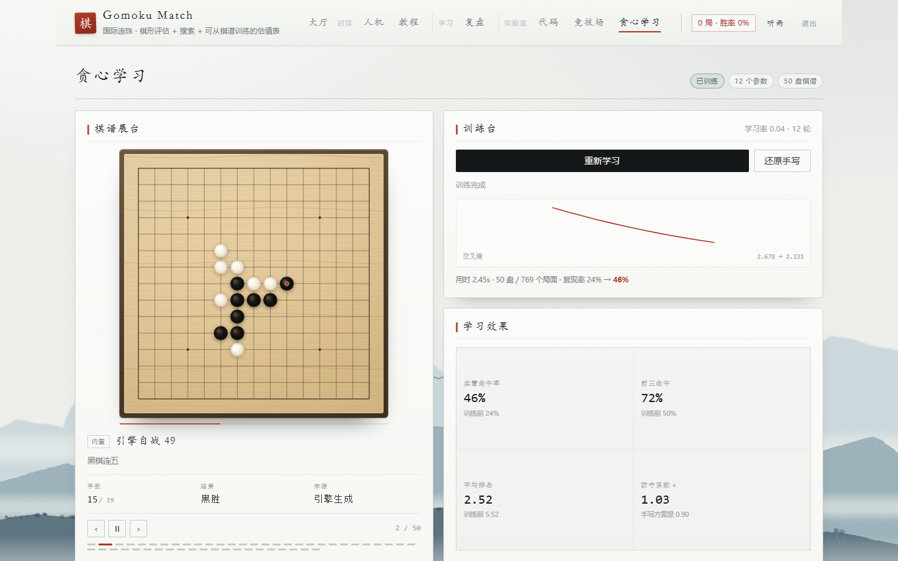
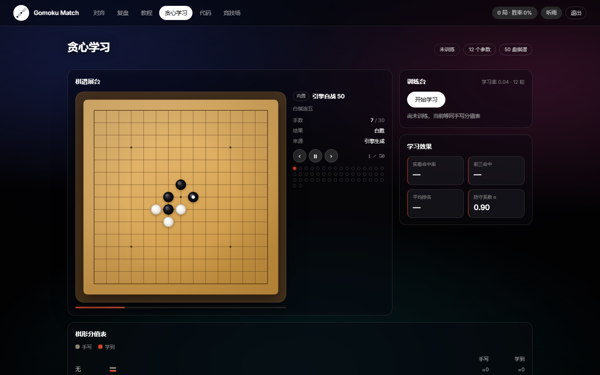

# Gomoku Match

[](https://gomoku-match.app.workbuddy.host/?sharecode=MJAKMJUVAA)
[](#测试)
[](#测试)
[](LICENSE)

面向 15×15 国际连珠（Renju）规则的对弈与算法实验平台，提供人机对弈、算法竞技场、自定义策略三类对局方式，以及基于棋谱训练贪心权重的实验页面。

单进程单端口部署：Python 进程同时提供 REST API 与前端静态资源；对局状态持久化于 SQLite，棋谱与训练权重存放于运行时数据目录。

`Python 3.13` · `FastAPI` · `SQLite (WAL)` · `原生 JS 静态 MPA` · `Docker`

**在线演示**：[gomoku-match](https://gomoku-match.app.workbuddy.host/?sharecode=MJAKMJUVAA)

后端测试 459 项、浏览器走查 189 项，全部通过。

| 贪心学习：训练之后的对照表 | 棋谱展台 |
| --- | --- |
|  |  |

| 首页 | 逐手解说 |
| --- | --- |
|  |  |

---

## 目录

- [功能](#功能)
- [界面体系](#界面体系)
- [架构](#架构)
- [数据层](#数据层)
- [可学习贪心](#可学习贪心)
- [可观测性](#可观测性)
- [测试](#测试)
- [部署](#部署)
- [目录结构](#目录结构)
- [本地运行](#本地运行)
- [规则与引擎](#规则与引擎)
- [API](#api)
- [问题记录](#问题记录)
- [许可](#许可)

---

## 功能

| 模块 | 说明 |
| --- | --- |
| 人机对弈 | 四档强度、三种风格；可选执子与规则，对局中可悔棋、提示 |
| 学习模式 | 逐手标注棋形名称，点评该手形成的棋形与对手活三的拦截情况 |
| 复盘分析 | 逐手回看，胜率曲线、落点份额与解说跟着手数走 |
| 贪心学习 | 手写分值表与学到的分值表并排对照；棋谱轮播、上传棋谱、训练过程实时可见 |
| 算法竞技场 | 随机／贪心／学习型贪心／极小极大／神经网络两两对打，结果可复现 |
| 代码工坊 | 自行编写 `choose_move`，Python 与 C++ 两条通道，共用同一套沙箱 |
| 教程 | 六章可交互棋盘，从棋规、棋形讲到禁手与开局规则 |

### 三种对局模式的差异

三种模式共用同一套搜索算法（棋形评估 + 极小化极大），没有一档由神经网络直接决策。差异在于候选落点的最终选择方，以及是否生成逐手点评：

| 模式 | 谁挑落点 | 每手点评 |
| --- | --- | --- |
| AI 对弈 | 搜索算法给出几个候选，再交给大模型挑一个；关掉模型、难度为入门（`noise=0.55`）或模型调用失败时，回落到人格权重 + 噪声 | 无 |
| 学习模式 | 与 AI 对弈完全相同，`use_llm` 的判定一致 | 有，`coach.py` 按棋形规则生成，不调模型 |
| 纯引擎 | 只用搜索算法，`use_llm` 强制为 `False` | 无 |

`games.py` 里是 `use_llm = req.use_llm and mode in ("agent", "learn")`，`agent.decide` 再叠一层 `LLMConfig().enabled and noise < 0.5`。在专家难度（`topk=1`）下候选池仅有一个落点，模型只生成解说；演武场中的神经网络策略为独立实现，不参与主线对弈。

### 页面职责划分

早期版本把模式选择、难度、规则、棋盘、胜率曲线、落点预测、解说与棋谱挤在同一页，开局配置与对局操作混在一起。现在拆成静态多页，每个页面只承担一类职责：

| 页面 | 职责 |
| --- | --- |
| `play.html` 开局准备 | 选对手、难度、规则、执子；选完提交 |
| `play.html?game={id}` 对局 | 只有棋盘和右侧三个页签（解说／分析／棋谱），顶部四个操作 |
| `replay.html` 复盘 | 逐手回看，分析面板在这里 |
| `greedy.html` 贪心学习 | 看棋谱、喂棋谱、看权重怎么变 |

配置与操作分离：难度、规则属于开局前参数，悔棋、提示属于对局中操作。对局结束后「悔棋」会禁用；要重下请开新局，避免已结算的战绩被再记一次。


帮助信息收敛为页头摘要与面板说明：页头一句话说明当前页面在做什么，面板标题下给一行用途说明；规则细节放在教程正文，不再额外做浮层。

---

## 界面体系

界面没有引入 UI 框架，全部为手写 CSS 与原生 JS，视觉围绕深色视频背景与玻璃面板展开。`web/site` 是线上静态站的源码，不是构建产物；页面直接引用 `app.css`、`styles.css` 和 `pages/*.js`，没有打包步骤。Inter、Geist Pixel、Bubbledot 与页头图标都走本地文件，不依赖 Google Fonts、OnlineWebFonts 或 Font Awesome CDN。

**令牌集中在 `app.css` 的 `:root`。** 底色 `--bg #050507`；正文 `--muted #a3a3a3`、`--dim #828282`；玻璃面板 `--panel rgba(9,10,14,.54)` 与 `--panel-2 rgba(26,27,33,.6)`，统一 `blur(28px) saturate(1.4)`；强调色只有两支：朱砂 `--seal #cf4529`（热、学到、上调、正在发生）与石青 `--jade #4e9a8f`（冷、基线、下调、对照）；棋盘专用木色 `--wood #dcac5f`。

```css
--bg: #050507;      --panel: rgba(9, 10, 14, 0.54);
--seal: #cf4529;    --jade: #4e9a8f;
--wood: #dcac5f;    --muted: #a3a3a3;
```

**背景是视频，不是图片。** 首页、登录页与所有内页共用同一段极光视频；`app.js` 的 `mountBackdrop()` 给内页注入 `.bg` 层，`login.html` 自带一层并用查重避免叠两段。视频上叠 `mix-blend-mode: screen` 色层托住暗部，再叠压暗与暗角保证文字对比度；`prefers-reduced-motion` 下隐藏视频，保留静态渐变。

**棋盘是木色的。** `app.js` 的 `BC` 用榧木渐变（`#e9c07c → #dcac5f → #c89442`）铺底，墨线网格、白子深描边；禁手叉与胜利连线用朱红，热力与落点预测用偏红/褐，避免在木底上消失。落点预测圈半径按份额缩放，但比棋子小，避免被读成空棋子位。

**代码工坊有语法高亮。** `pages/code.js` 用手写扫描器输出 token，透明 `textarea` 压在 `.code-hl` 上滚动同步；关键字靛蓝、函数木色、字符串石青绿、数字琥珀、注释暖灰。两层必须共用同一套字体、行高、内边距与 tab-size，否则高亮和光标会错位。

---

## 架构

```text
web/site/       原生 JS 静态 MPA —— 首页 · 登录 · 对局 · 复盘 · 教程 · 贪心学习 · 代码工坊 · 竞技场
  │
  │   HTTP /api/*
  ▼
app.py          装配层：中间件链 · 异常统一转换 · 静态站点托管
api/            accounts · games · lab · meta · greedy
─────────────────────────────────────────────────────────────────
settlement      终局结算（settled 落库，幂等，单人去向）
store           Game 对象：内存热态 + 每手落子持久化
accounts        账户 · 会话 · 战绩
corpus          棋谱库：内置种子 + 用户上传，三种格式解析
tuning          可学习贪心：特征、评分、训练、权重表
analysis · arena · lab · botzone · tutorial
─────────────────────────────────────────────────────────────────
repo.py         ← 全项目唯一写 SQL 的地方
db.py           ← 线程本地连接 · WAL · PRAGMA 迁移
  │
  ▼
data/gomoku.db    data/corpus.json    data/greedy_model.json
```

分层遵循一条约束：**SQL 仅允许出现在 `repo.py`**。上层获取的是 dict 而非 `sqlite3.Row`，更换存储时只需修改该文件。

### 一次落子的处理链路

1. 客户端 `POST /api/games/{id}/move`，`api/games.py` 校验归属、轮次与规则。
2. `Game.apply` 在内存里判定（禁手、胜负）。棋盘是增量结构：每落一子只更新受影响的四条线，不重算整盘。
3. 同一事务内向 `moves` 写一行。`game_id + ply` 为主键，重复写入天然幂等。
4. 轮到 Agent 时同步算出应手，把「落点 + 解说 + 候选份额」一起返回；讲解模式下面板停在待确认，等人点「继续」。
5. 终局时 `settlement.settle()` 执行，`recorded` 门与 `games.settled` 列共同保证幂等，随后记战绩、写终局状态。

第三步保证进程重启后可恢复：内存仅保留热态，每手落库一行，重启时按 `ply` 重放即可还原局面。

---

## 数据层

四张表，四个索引。

| 表 | 关键点 |
| --- | --- |
| `users` | `name_key` 存 casefold 后的名字并加唯一约束；胜负平、连胜与最佳连胜 |
| `sessions` | 主键为 token 的 SHA-256 摘要，库中不存明文；带过期时间，读取时清掉过期记录 |
| `games` | 建局人、模式、难度、规则、禁手策略、`human_color`、终局原因与胜利连线 |
| `moves` | `(game_id, ply)` 主键，一手一行，带来源、耗时与评估值 |

三个工程决定：

**WAL + `BEGIN IMMEDIATE`。** 默认的 rollback journal 下读写互相阻塞，落子与查询撞在一起就会触发 `SQLITE_BUSY`。WAL 让读不挡写；写事务起始即取写锁，不做锁升级，冲突时排队等待而不会直接报错。`synchronous=NORMAL` 省掉一次 fsync——WAL 下丢掉最近若干事务不会损坏数据库。

**每线程一个连接。** `sqlite3` 的连接对象不能跨线程使用。`threading.local` 比连接池简单，也不会因为忘记归还而泄漏。写冲突由 `busy_timeout` 处理。

**迁移只追加。** `PRAGMA user_version` 记录版本，`MIGRATIONS` 为只追加列表，启动时从当前版本向后执行。

真人房功能下线时验证了这条约束。v1 表结构包含房间、等级分与读秒字段；功能移除后若保留这些列，会为后续开发留下误导，并使 `SELECT *` 携带十个恒为空的字段。遵循「已发布的迁移不修改」原则，保留 v1 并新增只追加的 v2：

```sql
DROP INDEX IF EXISTS idx_games_black;      -- 索引引用了要删的列，必须先掉索引
ALTER TABLE games DROP COLUMN black_id;
...
ALTER TABLE users DROP COLUMN rating;
DROP TABLE IF EXISTS rooms;
```

顺序不可交换：`DROP COLUMN` 遇到引用该列的索引会直接报错。

### 冷热分层存储

`Game` 对象在内存中持有完整 `Position`：搜索、胜率曲线与禁手判定均高频读取，每次访问数据库无法满足性能要求。持久化只做两件事——每手写入一行 `moves`，重启时按 `ply` 顺序重放。

内存最多保留 400 局热态，超出部分按最久未活动淘汰，再次进入时从数据库载入。重放时补充一次终局判定：若进程在落子后、写状态前退出，库中状态仍为 `playing`，但棋盘已连五。

---

## 可学习贪心

贪心策略的评估函数是一张棋形分值表，共十二项。初始版本手工设定 `WEIGHT`（活四 1000 万、冲四 15 万、活三 1500、眠二 30），数值之间仅有粗略的倍数关系，缺少数据依据。

`greedy.html` 页面使用棋谱训练这组权重。

### 参数与特征

评分形式保持贪心的原样，只是权重变成可训练的：

```text
score = Σ_r w[r] · (f_own[r] + α · f_opp[r]) + 邻域·w1 + 中腹·w2 + 手数·w3
```

- **19 维特征**：8 档己方棋形 + 8 档对方棋形（落这一子之后会形成什么）+ 邻域已有子数 + 离天元的距离 + 当前手数占总格数的比例。后三项用于表达开局偏好中腹、残局偏好贴身等先验。
- **12 个参数**：8 个棋形权重 + 3 个辅助权重 + 1 个防守系数 α。
- **防守不是独立的一张表**，而是与进攻共用 w、只差一个系数。第一版为防守设置 8 个独立权重，训练后全部收敛至 0：样本仅数百条时，对手威胁与己方机会的梯度相互抵消，模型退化为只优化进攻。改为共用权重 + 标量 α 后，α 收敛至 1.03，即「对手的活三比己方活三略更值得封堵」由数据得出，不再依赖人工设定。

### 训练目标

行为克隆。每个局面里棋谱走的那一手是正样本，同局面的其它候选点是负样本，对候选集做 softmax 交叉熵：

```text
loss = -log softmax(score)[target]
```

候选集按手写分值取前 20 个（候选全集每步约两百个空点，绝大多数为噪声），目标手保证在集合内。优化器为手写 Adam（lr 0.04、12 轮、L2 约束至手写初值），纯 Python 实现，不依赖 numpy；样本量为千级，单轮训练耗时数十毫秒。

### 领域约束投影

每轮更新后将权重投影回可行域，三条约束均来自棋理，而非调参经验：

- 空棋形不值分（`w[0] = 0`）；
- 分值随棋形变强单调递增（活四 ≥ 冲四 ≥ 活三 ≥ …）；
- 防守系数限定在 `[0.2, 1.6]` 之间，并保留余量，避免落在边界导致梯度恒为零。

不做投影时，模型会将「眠二」权重压为负值以拟合噪声，对照表随之失去可解释性。

### 评估指标

初期以「训练后与贪心对局 4 盘」为指标，结果稳定为 0:4。单局胜负主要取决于执黑方与开局随机性，无法反映权重质量，因此改用验证集复现率：

| 指标 | 含义 | 训练前 | 训练后 |
| --- | --- | --- | --- |
| 实着命中率 top-1 | 第一选择正好是棋谱走的那一手 | 24.2% | **46.4%** |
| 前三命中 top-3 | 前三个候选里有没有 | 50.3% | 71.9% |
| 平均排名 | 目标手排第几（越小越准） | 5.52 | 2.52 |

验证集取样本序列末 1/5，**按序切分而非随机切分**：同一局相邻局面特征高度相似，随机切分会使验证集混入训练时已见过相邻步的局面，导致命中率虚高。

三项指标衡量的是对棋谱的复现程度，而非棋力；需要观察实际对局表现时，可在竞技场选择「学习型贪心」策略。

### 棋谱来源

内置 50 盘、2067 手，由 `tools/make_corpus.py` 生成：深度 2 的 alpha-beta 与深度 1 对打，每盘轮换执深搜的一方。早期以贪心 + 噪声自战生成，棋局仅 13–27 手，训练结果只是对手写分值表的模仿，eval 回落至 0.25。改用带搜索的棋谱后，同一套代码在 50 盘上的 top-1 从 0.242 提升至 0.464（验证集为样本序列末 1/5 的 153 个局面）。

页面上的棋谱库同时接收用户上传，支持三种格式：

```text
(;GM[1]SZ[15];B[hh];W[hi])     SGF
[[7,7],[8,8]]                  JSON
H8 H9 I9  /  7,7 8,8           人类坐标
```

解析后重放校验合法性：重复落子、坐标越界、少于 5 手均返回错误；连五之后的手数自动截断，以处理认输前继续落子的棋谱。

训练过程通过 SSE 推送，前端实时显示训练轮次与损失（例如「第 4/12 轮、交叉熵 2.78 → 2.25」），而非轮询等待。

---

## 可观测性

未引入 Prometheus 客户端与结构化日志库。指标、日志、限流三部分合计 340 行（`server/observability.py`），无第三方依赖：

**指标。** 自写的 counter / histogram / gauge，`/api/metrics` 直接输出 Prometheus 文本格式。覆盖请求量与延迟直方图、活局数、热态局数、被限流的请求数、落子数、棋谱上传与训练次数。

标签仅按**路由模板**（如 `/api/games/{game_id}`）打点，不按真实路径。真实路径由外部输入决定，扫描器可将时间序列规模放大至数万条，写入 Prometheus 后难以清理。限流计数器同理，按命中的规则前缀分桶。

**日志。** 单行 JSON：`ts / level / logger / msg / request_id / method / path / status / ms / route`。`request_id` 继承自 `X-Request-Id`，缺省时生成并写回响应头。

**限流。** 固定窗口计数，按 IP 或按 token 分桶，定时回收过期桶。登录与注册 30 次每分钟（按 IP），改密码 20 次每分钟（按用户），默认 1200 次每分钟。取客户端 IP 时用 `X-Forwarded-For` 的**最后一跳**——前面的值可以伪造。

两个探针分工不同：

- `/api/health` 不碰磁盘，只证明进程存活（liveness）。
- `/api/ready` 实际执行一次数据库写入并检查前端静态站，任一失败返回 503（readiness）。

容器 HEALTHCHECK 使用 `ready`：仅返回 200 而数据库不可用，不满足就绪条件。

---

## 测试

```bash
python tools/run_tests.py            # 后端六套，自行启动服务、临时库、随机端口
python tools/run_tests.py --fast     # 跳过需要服务的端到端套件
python tools/walk_greedy.py          # 贪心学习页走查（自启服务与浏览器）
python tools/walk_analysis.py        # 准备页 / 对局页 / 复盘页走查
python tools/walk_layout.py          # 七页 × 五档宽度的横向溢出复检
python tools/walkthrough.py          # 全站八个页面走查
```

| 套件 | 覆盖 | 项数 |
| --- | --- | --- |
| `test_engine.py` | 禁手递归、长连、胜负、搜索、棋形 | 37 |
| `test_lab.py` | 代码沙箱、行协议、超时与越权 | 28 |
| `test_insight.py` | 胜率、落点份额、解说、逐手分析 | 104 |
| `test_storage.py` | 迁移、WAL、会话、棋谱重放、单人结算、结算标记、旧数据导入 | 88 |
| `test_greedy.py` | 棋谱解析、棋谱库、参数投影、训练与验证指标 | 85 |
| `test_api.py` | 接口契约、鉴权通道、静态目录边界、越权 403、贪心训练流、限流与指标分桶 | 117 |
| `walk_greedy.py` | 轮播、训练流、分值表、上传删除、窄屏断点 | 47 |
| `walk_analysis.py` | 准备页选项、页签切换、待确认落子、逐手回看 | 53 |
| `walk_layout.py` | 七个页面在 1440/1100/900/760/414 下都不出横向滚动条 | 42 |
| `walkthrough.py` | 注册、首页、教程、对弈、学习、代码工坊、竞技场、战绩 | 47 |

`tools/run_tests.py` 每次启动独立进程（临时库、随机端口、临时数据目录、`NO_PROXY`），结束后清理，测试之间不共享状态，也不会污染 `data/`。数据目录需与库文件一同切换：仅替换库文件时，单次测试就会覆盖已训练的权重表。

### 浏览器走查的断言范围

接口测试无法覆盖交互行为。走查脚本通过 CDP 直连 DevTools 协议，固定视口后截图，使布局断言可复现。

`walk_greedy.py` 中与该页面相关的断言：

- 棋盘逐手推进：断言等待手数增长而非固定时长；单盘结束有 2.4 秒停留，固定等待会落在停留期
- 鼠标悬停暂停轮播：通过 CDP `Input.dispatchMouseEvent` 派发真实移动事件；页面直接监听原生 `mouseenter` / `mouseleave`
- 训练耗时约一秒，进度线仅在 epoch 事件间出现，因此采用轮询采样而非定点断言
- 分值表色条不越出所属栏位，数字列在 1440 与 1024 宽度下对齐
- 上传棋谱后列表新增一行、展台同步切换；删除后恢复原状

`walk_layout.py` 专门覆盖断点：其余走查仅检查 1440 一档，无法发现窄屏横向溢出。五个宽度 × 七个页面，同时检查两条判据——页面的 `scrollWidth` 是否超过视口，以及是否存在越过视口边缘的元素。仅检查前者不足：元素溢出且父级为 `overflow: hidden` 时，页面不出现滚动条但内容已被裁切。

页面结构调整会使既有走查断言批量失败；改版时先失败后通过，可用于确认改动影响范围。

---

## 部署

```bash
make docker            # 单阶段构建：Python 运行时 + web/site 静态文件
make docker-run        # docker compose up -d，数据挂载在 gomoku-data 卷
```

镜像内不含 Node、`node_modules` 与前端工具链：`web/site` 是已经写好的静态多页站，Dockerfile 直接复制，没有构建步骤。以 uid 10001 的非 root 用户运行，`/data` 单独建目录并 chown，挂载卷时权限才能对应。

| 变量 | 默认 | 说明 |
| --- | --- | --- |
| `PORT` | `8000` | 容器内必须绑 `0.0.0.0`，不可写 `127.0.0.1` |
| `GOMOKU_DATA` | `data/` | 运行时数据目录：库、上传的棋谱、权重表都在这里，挂一个卷就能整体搬走 |
| `GOMOKU_DB` | `$GOMOKU_DATA/gomoku.db` | 单独指定库文件；只读文件系统下降级为内存库 |
| `GOMOKU_LOG` | `INFO` | 日志级别，输出为单行 JSON |
| `GOMOKU_CORS` | 本地两个端口 | 线上同源部署，留空即可 |
| `GOMOKU_LLM_*` | 空 | 可选的模型接入，兼容 OpenAI 接口；未配置时使用内置人格决策 |

单进程是有意的设计：对局状态保存在内存中，多 worker 会导致各进程持有部分棋局。横向扩展需先将热态迁移至共享存储，属于独立的改造范围。

CI 矩阵：Python 3.11 与 3.13，执行 `compileall`、静态站点存在性检查、全部测试、`docker build`（不推送）。前端没有构建步骤，不需要 Node。

### 托管在 WorkBuddy 云平台

线上运行于 WorkBuddy 发布沙箱，与 Docker 部署为两条独立路径。差异如下：

- **启动命令需显式指定。** 平台的 Python 探测默认查找 `main.py`，本项目入口为 `serve.py`，不指定会因 `can't open file '/workspace/main.py'` 启动失败。发布时传入 `startCmd = python serve.py`。
- **前端目录不能命名为 `dist/build/out`。** 上传时这些目录会被平台当作构建输出剔除，服务可启动但只有接口没有页面；`/api/ready` 会明确返回 `frontend.ok = false`。静态站因此放在 `web/site`，路径统一由 `server/db.py` 的 `WEB_DIST` 提供。
- **鉴权 token 通过 Cookie 传递。** 分享网关会为每个请求注入自身的 `Authorization` 头，覆盖浏览器发送的值，因此服务端按 cookie → query → 自定义头 → 标准头的顺序读取 token。
- **模型密钥通过 `.env` 提供。** 平台仅向容器注入 `PORT`，`GOMOKU_LLM_*` 无配置入口。`serve.py` 启动时将项目根目录 `.env` 读入 `os.environ`（已有环境变量优先）；密钥随项目上传即可生效，`.env` 已在 `.gitignore` 中排除。未配置时不影响启动，`/api/health` 返回 `llm.enabled = false`，Agent 回落到内置策略人格。
- **WAF 会误判请求体中的源码。** 代码工坊提交的模板文本会被注入规则拦截并返回 HTML 拦截页。传输层提供 `_enc=b64` 备用通道，默认仍以明文发送。

发布前确认 `web/site/index.html` 存在即可，不需要前端构建；`web/site` 已纳入 Git，随项目根目录一起上传。

---

## 目录结构

```text
server/
  app.py            装配层：中间件、异常处理、静态站点托管
  db.py  repo.py    连接与迁移 / 唯一 SQL 出口
  paths.py          运行时数据目录（库、棋谱、权重表都挂这里）
  store.py          Game 对象、冷热分层、重放
  accounts.py       账户、会话、战绩
  settlement.py     终局结算（settled 落库，幂等）
  corpus.py         棋谱库：解析、增删、训练集
  analysis.py       胜率与落点份额
  observability.py  指标、JSON 日志、限流、安全头
  softbody.py       base64 请求体的解码中间件（绕开 WAF 误判）
  runtime.py        进程级单例，打断循环引用
  api/              accounts games lab meta greedy deps
  gomoku/
    rules.py        禁手与胜负判定
    position.py     棋盘与增量状态
    shapes.py       棋形识别
    search.py       迭代加深 + 置换表
    tuning.py       可学习贪心的特征、训练与权重表
    agent.py        人格决策
    algorithms.py   随机 / 贪心 / 学习型贪心 / 极小极大 / 神经网络
    net.py          局面价值网络
    coach.py        点评   insight.py  逐手解说   llm.py  可选模型
    corpus_seed.json  内置的 50 盘棋谱
web/site/
  index.html        首页（登录门禁）
  login.html        登录 / 注册
  play.html         开局准备 + 对局
  replay.html       复盘
  tutorial.html     教程
  greedy.html       贪心学习
  code.html         代码工坊
  arena.html        算法竞技场
  app.js            共享运行时：API 客户端、登录守卫、棋盘、DOM 工具
  pages/*.js        各页面脚本
  app.css           内页主题
  styles.css        首页主题
  assets/           背景视频与 logo
  fonts/            自托管字体（Inter / Geist Pixel / Bubbledot）
tests/              六套后端套件
tools/              run_tests.py、walk_*.py、cdp.py、harness.py、make_corpus.py
engine/             代码工坊的 C++ 示例模板（沙箱内编译）
```

---

## 本地运行

```bash
make install      # pip install -r requirements.txt
make serve        # 单端口运行（:8000），与线上一致
make test         # 全部测试
make test-fast    # 跳过端到端套件
make clean        # 清理缓存与旧前端依赖，不动 web/site 与 data/
```

---

## 规则与引擎

**三三判定需要递归。** 一个「三」成立，必须存在一个补点能将其变为活四；而该补点本身不能是黑棋的禁手点，否则构成假活三。因此判三要先判四，判四又要判断补点是否为禁手：

```python
after = stones.put(gap, color)                    # 假设补一子
four = _open_four(after, ex, ey, dx, dy, color)
if four is None or center not in four:
    continue
if depth > 0 and _forbidden(after, ex, ey, color, depth - 1) is not None:
    continue                                      # 补点本身是禁手 → 假活三
found.add(frozenset(i for i in four if i != gap))
```

递归最多两层：每补一子棋盘减少一个空点，不会无限进行。该差异直接影响判定结果——测试用例中，不带递归计得 2 个活三（误判三三禁手），带递归计得 1 个（合法）。

**「四」按四颗子的位置集合去重。** 活四两端都能成五，若按成五点的个数统计，任何活四都会算作两个四，于是每个活四点都成了四四禁手。`_XXXX_` 从左窗口、右窗口各命中一次，但那是同一组四颗子，只计一个。

**引擎在候选排序阶段即滤除禁手点**，判定结果按 `(局面哈希, 落点)` 缓存：迭代加深会反复回到同一局面，不缓存时该步骤开销高出一个数量级。代价是深度 5 单次搜索由 1.2s 增至 1.9s；收益是不再将禁手点作为进攻手段——同一局面下，未做过滤的版本会给出 899 万分的「必胜」判定，实际为三步后的长连禁手。

**落点价值采用增量评分**，不做整盘重算：每落一子只更新受影响的四条线及其棋形。`shapes.py` 中「再补一子会变成什么」的判定由搜索、学习模式、局面分析与可学习贪心四处共用——同一套棋形识别，喂给不同的决策器。

### 神经网络策略的边界

演武场里的神经网络是独立实现，不参与主线对弈。34 维局面特征（四个方向各 5 项 + 14 项全局）进两层隐藏层（48 与 24）再输出一个 0~1 的落点分值，权重合计 2881 个，前向传播纯 Python 手写，不引入 numpy。

训练方式是蒸馏：让搜索深度 3 的引擎自对弈，把引擎实际走的那一手当正样本、同局面里随机抽的合法点当负样本，用二元交叉熵拟合——模仿的是搜索的判断，而非从零学会对局。训练脚本用 numpy 写梯度（`tools/train_net.py`），推理侧不背这个依赖。

网络自身只给候选点打分，不展开搜索树。竞技场里的「神经网络」策略在这之上加一层：按分数取 Top-K 候选，逐点试下，再用网络评估对手的最强应手，取净价值最高的一手（应手分打 0.75 折扣，因为对手未必真的下得成）。因此它强于纯贪心、弱于带搜索的引擎——这个差距是真实的，也是竞技场里值得看的对照。

**网页对局默认拦截禁手并说明原因**（棋盘上标红叉），便于先理解规则；设置中可切换为赛制模式：落子即判负，结果栏说明禁手类型。

### 先手优势与开局规则

**禁手不等于消除先手必胜。** 无禁手五子棋的黑棋存在必胜策略；只加三三、四四、长连禁手的原始连珠后来同样被证明先手必胜。禁手削弱的是黑棋可用的双重威胁手段，没有改变「黑棋先落第一手」这个次序。

**赛制靠开局规则平衡。** 三手交换让摆局方不敢摆必胜变化——对手可以直接换过去执黑；五手两打让黑方给出两个第五手候选、由白方挑走一个，把最有利的变化交给对手。两者合起来是长期使用的 RIF 开局规则，山口规则、Soosõrv-8、Taraguchi-10 继续增加候选点与交换次数，用来排除被开局库研究透的必胜变化。现代赛制下尚未证明存在先手必胜策略。

**本项目的边界在棋规层。** `rules.py` 实现三三、四四、长连禁手与 `renju / freestyle` 切换，`NewGameRequest.human_color` 让开局前直接指定执黑或执白；网页对局自第一手起即为完整对弈，先手归属交给玩家决定。换手逻辑只在 `botzone.py` 的协议适配层保留：按对手第三手的落点价值决定是否交换颜色，服务机器对机器的赛事接入。

**赛制开局是另一条线。** 完整实现需要把一局拆成「摆局 → 交换 → 给候选点 → 正式对弈」的分阶段状态机，落子接口、棋谱格式与复盘回放都要带阶段标记，竞技场的可复现对局也要同时按两套流程运行。这属于赛事规则适配，与本项目要展示的棋形评估、搜索、Agent 分层互不重叠；人机练习场景下，先手归属在开局前确定即可。

---

## API

| 域 | 路由 |
| --- | --- |
| 账户 | `POST /api/auth/register\|login\|logout\|password` · `GET /api/auth/me` |
| 战绩 | `GET /api/profile/{name}` · `GET /api/history` |
| 对局 | `POST /api/games` · `GET /api/games/{id}` · `POST /api/games/{id}/move\|undo\|resume\|hint\|review\|explain` |
| 贪心学习 | `GET /api/greedy/status\|corpus` · `GET /api/greedy/corpus` · `POST /api/greedy/corpus` · `DELETE /api/greedy/corpus/{id}` · `POST /api/greedy/train\|reset` |
| 实验室 | `GET /api/lab/capabilities\|samples` · `POST /api/lab/match\|verify` · `POST /api/arena/match` · `POST /api/neural/scan` · `POST /api/botzone` |
| 元 | `GET /api/health\|ready\|metrics\|config\|system\|tutorial\|algorithms` |

---

## 问题记录

**代理环境变量会劫持 127.0.0.1。** 环境存在 `HTTP_PROXY` 时，httpx 默认 `trust_env=True`，访问本地测试服务同样经过代理并返回 502。测试客户端统一 `trust_env=False`，测试启动脚本设置 `NO_PROXY`，CDP 客户端单独使用空 `ProxyHandler` 的 opener。

**单文件 JSON 存账户造成写放大。** 早期账户存于一个 JSON 文件，每次读 token 需遍历全部会话（O(n)），每次写需落整个文件。改用 SQLite 后 token 按主键查询，写入仅影响单行。旧数据做了幂等导入：保留原 token 摘要，用 `user_exists` 作为判断条件，重复执行不会产生重复账户。

**静态目录路径穿越。** 静态托管兜底路由直接把请求路径拼到 `web/site` 下，`/..%2F..%2F.env` 能读到项目根目录的环境变量与 `data/gomoku.db`。修复方式不是拦 `..` 字符串，而是把最终路径 `resolve()` 后要求它仍在 `DIST_ROOT` 内，并拒绝以 `.` 开头的路径段；测试补了 `README.md` 与 `.env` 两条 404 断言。

**终局后悔棋会重复记战绩。** 对局结束后 `undo` 仍可用，接口把 `recorded` 重置为 `False`，再次终局就再记一次。修复是双保险：前端在 `status !== 'playing'` 时禁用悔棋，后端直接返回 409；同时把结算标记落到 `games.settled`，重载后不会把同一局当成未结算。

**前端事实源曾经分叉。** 线上是 `web/site` 静态多页站，仓库里却是 React/Vite 的 `web/src`；`web/site` 被 gitignore，`make build` 会用旧 React 产物覆盖它，`make clean` 会直接删掉它。现在 `web/site` 是唯一前端源码并纳入 Git，构建/开发脚本移除，Dockerfile 直接复制静态文件，CI 只检查静态站点存在。

**视频背景会压低正文对比度。** 极光视频的亮部会穿过半透明面板，灰色正文在滚动到亮带时读不清。处理分三层：`body::before` 静态渐变兜底、`.bg-video` 压暗与降饱和、`.bg::after` 再叠压暗与暗角；裸文字额外加大半径 `text-shadow`。这类问题 DOM 断言查不到，仍需截图确认。

**画布尺寸在后台标签页会停在旧值。** 棋盘构造时硬编码 560，ResizeObserver 修正走 `requestAnimationFrame`；后台标签页被节流时，画布会停在 560 横在 348 的框上。修法是 `draw()` 每次先按容器 `clientWidth` 校正，不依赖渲染帧。

**指标标签基数存在风险。** 第一版按真实路径打标签，`/api/games/{id}` 每局一个新 id，时间序列只增不减。改为按路由模板打标签后才是闭集。

**前端目录放在 `dist/` 会被发布平台剔除。** 首次上线时接口全部正常、`/api/health` 返回 200，但首页返回应用自身的 404，原因是前端产物没上传。发布沙箱将 `dist`、`build`、`out` 一律视为构建输出排除。`/api/ready` 直接暴露该问题（`frontend.ok = false`，并附带查找路径），避免误判为路由错误。静态站最终放在 `web/site` 并纳入 Git；目录名不要改回 `dist`。

**分享网关为每个请求注入 `Authorization`。** 线上登录成功后，后续请求仍回落至登录页，本地测试全部通过。排查确认：四种 token 传递通道中，标准头被网关以自身凭据覆盖（而非丢失），因此表现为「携带认证信息但不属于当前用户」。

通过两个对照实验定位：一是不携带任何鉴权信息发请求时，`/api/health` 返回的 `auth_seen` 仍报告 `header` 为真，说明该头并非客户端发送；二是将优先级调整为 cookie → query → 自定义头 → `Authorization` 后问题消失。前端登录时同步写入 `SameSite=Lax` cookie，测试补充「cookie 优先于被网关覆盖的标准头」断言，固定该顺序。

**云端 WAF 会把源码判成注入。** 代码工坊点击「校验」返回 403，页面仅显示「请求失败 (403)」，同一套接口在本地全部通过。打印原始响应体后可见 `<title>WAF拦截页面</title>`，说明请求在到达应用前已被拦截。

二分定位：按行截断模板逐次提交，49 行通过、51 行被拦，首次触发语句为 `if abs(x - 7) > 6 or abs(y - 7) > 6:`。继续收窄后，规律为「两处带比较的函数调用通过 `and`/`or` 或 `&&`/`||` 连接」。该形状常见于布尔盲注 payload，规则本身合理，但用于判定源码属于误判。仅修改模板无法覆盖用户自定义 bot，因此采用两层处理：模板先计算距离再比较（`dx, dy = abs(x - 7), abs(y - 7)`，后续评分复用），默认路径避开该形状；传输层提供备用通道，前端收到「403 且响应非 JSON」时将请求体 base64 编码并携带 `_enc=b64` 重发，由 `SoftBody` 中间件解码还原。

默认以明文发送：平台检查照常生效，备用通道仅用于误判场景。中间件另有一个约束：请求体读取完毕后，后续 `receive` 不能返回 `http.disconnect`，否则 SSE 断连监听会立即取消流，导致对局直播中断。

**棋谱轮播的定时链。** 静态版 `greedy.js` 的 `startCarousel()` 每次调用都新起一条 `setTimeout` 链，点棋谱、上传、悬停几次后几条链并行，`ply` 加速、选中行被另一条链顶掉。修法是全局 `carouselTimer`：`startCarousel` 先 `clearTimeout`，`mouseleave` 时重新起链。

---

## 许可

本项目采用 [MIT 许可](LICENSE)。
